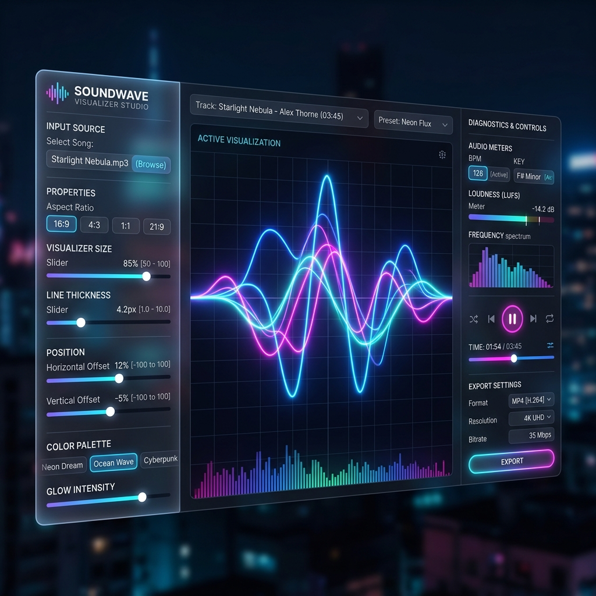

# RADIO WAVE v6.66

A Windows Electron player combining the Soundwave visualizer and local playback
with 666 WebRadio and SoundCloud integration. The project is based on
Soundwave Studio and retains its visualizer and export features.



---

## 🌟 Key Features

### 1. 15 Premium Visualizer Designs
Equipped with 15 custom mathematical frequency and time-domain visualizer modules, including:
*   **AI Voice Assistant Wave**: Premium voice assistant wave utilizing **7 overlapping mathematical Gabor curves** blending additively (`lighter` composite blend mode) with multi-colored neon gradients (Aqua, Fuchsia, Purple, Emerald, Blue, Gold, White) and a gentle glowing dormant baseline that breathes when silent (**Shutterstock ID 2435987339**).
*   **Orbital Voice Blobs**: Siri/Google-style glowing blobs that dynamically scale, separate, and morph in response to treble peaks and overall volume (**Shutterstock ID 2416549429**).
*   **Fluid Wave Curves**: Continuous liquid-like undulating Bezier curves with mirrored transparent shadow waves flowing across the screen.
*   **Digital Matrix HUD**: Futuristic digital block matrix grid frequency analyzer.
*   **Digital Water Ripple**: Mimics concentric ripples expanding outward from a central pulsing liquid droplet, accompanied by floating particles curving in dynamic wave-like trajectories (**Shutterstock ID 2653154933**).
*   **Volumetric Glow Ribbon**: Overlapping, ultra-smooth wavy horizontal ribbons creating a volumetric 3D-looking soundwave belt (**Shutterstock ID 2770068617**).
*   **Equalizer Wave Ribbons**: Translucent multi-layered vertical wave ribbons (Fuchsia, Cyan, Emerald, Amber) filled with bright linear gradients that bounce to distinct frequency bands (**Shutterstock ID 1925468375**).
*   **Digital Matrix Sphere**: A gorgeous 3D rotating spherical network lattice of interconnected nodes that expands and glows intensely to specific frequency ranges (**Shutterstock ID 2419414219**).
*   **Neon Fiber Wavefront**: A hyper-dense pack of 45 ultra-thin glowing threads weaving together into a cosmic fiber bundle that wiggles and warps in response to high-frequency transients (**Shutterstock ID 2174901063**).
*   **Circular Ripple Rings**: Concentric radial frequency bars extending from a glowing circular base. The base radius pulses in sync with the bass, and peak frequencies emit glowing particle sparks.
*   **Neon Oscilloscope**: Raw time-domain green light waveform beam.
*   **3D Wireframe Orbit**: 3D rotated perspective concentric rings warping dynamically to bass and treble frequencies.
*   **Mirrored Wave Borders**: Symmetrical glowing wave boundaries placed at the top and bottom of the frame for elegant edge framing.
*   **Glowing Linear Bars**: Classic neon frequency spectrum bars equipped with peak level falling indicator dots (increased density to 120 lines).
*   **Radial Starburst Particles**: Emits hundreds of starry glowing particles floating from the center outward, whose speed and size scale with the bass kicks.

### 2. Custom Layout & Styling Panels
*   **Position & Size Sliders**: Precision sliders for *Size Scale*, *X-Position (Horizontal Offset)*, and *Y-Position (Vertical Offset)* to place the visualizer anywhere on screen.
*   **Custom Overlays**: Toggle glowing titles, artist tags, diagnostic BPM tags, and live bass peak meters.
*   **Dynamic Backgrounds**: Load custom background images (PNG, JPG, WebP) directly from your files.
*   **Aspect Ratio Toggle**: Render in Widescreen (16:9) or Vertical (9:16) for YouTube Shorts, TikTok, and Instagram Reels.

### 3. Video Exporter
*   Choose an MP4 or WebM destination using the file browser. Recording shows
    elapsed time and progress when the audio duration is known.
*   Canvas and audio are recorded in real time; available codecs and achievable
    frame rate depend on the machine. A finished file is reported only after
    it has been written successfully.

### 4. Zero Installation Portable Build
*   Runs instantly with **no installer, setup screens, or administrator access** required.

---

## 🚀 How to Run

On Windows, open `RADIO_WAVE.bat` in this project folder and choose **1** to
start the player. The launcher checks the local dependencies first; see
[START_HIER.md](START_HIER.md) for setup and targeted Electron runtime repair.
The portable ZIP and NSIS installer are built locally using the launcher;
they are not included in a source checkout.

The window dock opens and closes each overlay. Use an overlay's detach button
to move it to another monitor; the visualizer has its own detach button.
The main screen also provides links to the radio and LYVRA websites.

Use **Media Library** to browse for local audio. **Audio Pool & Playlists**
scans a folder selected by the user, refreshes it automatically, and manages
named playlists without moving or deleting the audio files. In the player bar,
the radio route selector offers automatic failover or manual Main/Fallback.
SoundCloud credentials can be saved using the operating system's encrypted
storage; see [SoundCloud setup](docs/SOUNDCLOUD_SETUP.md).

**Audio Devices** selects supported input and output devices. Microphone input
is opt-in and never monitored through speakers; recording it requires a
separate explicit choice.
**Audio FX · EQ** provides independent three-band playback EQ and stereo width; see
[Audio FX](docs/AUDIO_FX.md) for the Light Wave attribution and limitations.
The bundled MilkDrop Cyber Studio manages and generates presets; it is not a
live MilkDrop/Spout renderer.

---

## 🛠️ Developer Setup & Rebuilding

If you want to run the project in development mode or compile it yourself:

### 1. Install Dependencies
Make sure you have Node.js installed, then run:
```powershell
npm ci --include=dev --foreground-scripts
```

### 2. Run in Dev Mode (Hot Reload UI)
To launch the Electron app:
```powershell
npm start
```

### 3. Build & Optimize Portable Package
To compile a portable Windows ZIP:
```powershell
npm run package
```
This runs the automated build script located at `scripts/build.js`.
For an NSIS installer and standalone portable EXE, run `npm run dist`.
Both bundle Electron; Node.js and the build tools are not required on the
target PC.

---

## 📁 Project Structure

*   `main.js`: Main desktop process handling native Windows bridges, hardware acceleration, and direct stream saving.
*   `preload.js`: Secure IPC context bridge interfacing renderer logic with the Windows filesystem.
*   `src/index.html`: Modern Glassmorphic control dashboard and live renderer canvas.
*   `src/style.css`: Sleek responsive dashboard stylesheet equipped with glowing visual cues.
*   `src/app.js`: Audio Analyser, visual preset mathematical curves, and MediaRecorder stream capture.
*   `scripts/build.js`: Automated optimization and build post-processing pipeline.
